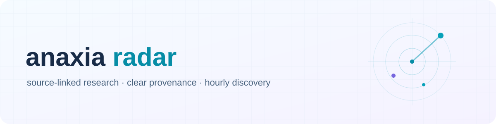

<p align="center"></p>

<p align="center"><strong>Follow the research. Keep the evidence.</strong><br>Public mathematics metadata, clear source history, and an hourly review queue.</p>

<p align="center"><a href="docs/RESEARCH-RADAR.md">research digest</a> · <a href="data/research-radar.json">public snapshot</a> · <a href="config/research-watch.json">watch settings</a> · <a href="mailto:egspl@proton.me">contact</a></p>

anaxia radar is a standalone research discovery tool extracted from [anaxia](https://github.com/anaxia-research/anaxia). It follows configured GitHub repositories, arXiv mathematics searches, MathOverflow, Mathematics Stack Exchange, and curated research blogs. Each refresh preserves source identities, capture times, attribution, pagination limits, and failures.

It runs on Python 3.10 or later with **no runtime dependencies**. The checked-in snapshot is a dated public capture. The offline example is explicitly synthetic.

## latest capture

<!-- ANAXIA:RADAR:START -->

Run `python -m anaxia_radar show` to inspect the checked-in capture.

<!-- ANAXIA:RADAR:END -->

## get started

From this repository:

```sh
python -m anaxia_radar show
python -m anaxia_radar --help
```

Install the standalone command:

```sh
python -m pip install .
anaxia-radar show
```

Try the recorded example without contacting any service:

```sh
anaxia-radar refresh --offline examples/radar-fixture.json --output .test-output/snapshot.json --digest .test-output/digest.md
```

The example writes to a separate directory so the public capture remains available.

## choose the research you follow

Edit [config/research-watch.json](config/research-watch.json), then refresh:

```sh
anaxia-radar refresh --config config/research-watch.json --readme README.md
```

The initial watch list preserves the upstream `creelie` account and mathematics searches. Replace `github.owners` with the accounts or organization you want to follow. Query counts and page sizes are bounded and validated. The blog list deliberately uses the two curated primary feeds already supported by the implementation.

Inside this repository, the local watch file is used automatically. When installed elsewhere, the packaged defaults are available; output goes into `data/` and `docs/` under the current working directory. Pass `--config`, `--output`, and `--digest` to choose other paths.

An optional `GITHUB_TOKEN` or `GH_TOKEN` is sent only to `api.github.com`. The radar respects arXiv pacing and Stack Exchange backoff, retains previous successful records during partial source outages, and reports truncated coverage.

## hourly discovery

[The refresh workflow](.github/workflows/refresh.yml) requests an hourly run and can also be started manually. It updates only the snapshot, digest, and marked README section. Timing depends on GitHub Actions availability, and branch rules may require configuring how the workflow saves updates.

Discovery covers the configured, bounded sources. A phrase such as “we conjecture” creates a **review candidate** with an excerpt and exact offsets; it does not establish that the problem remains open. Community answer flags also remain source metadata. The radar does not execute discovered code, certify proofs, or submit papers.

## verify the extraction

```sh
python -m unittest discover -s tests -v
```

The upstream radar regression suite checks pagination, attribution, stale captures, API backoff, XML and decompression limits, rendering, and preservation of existing output after total source failure. Standalone checks cover the module entry point and operation from another working directory.

## provenance and reuse

Software: [MIT](LICENSE), copyright © 2026 Deep Bhattacharjee. [NOTICE](NOTICE) and [SOURCE-ORIGIN.json](SOURCE-ORIGIN.json) preserve the extraction source and file hashes. Third-party records retain their original source terms and attribution; see [metadata reuse](docs/METADATA.md).

Contact: **[egspl@proton.me](mailto:egspl@proton.me)**.
